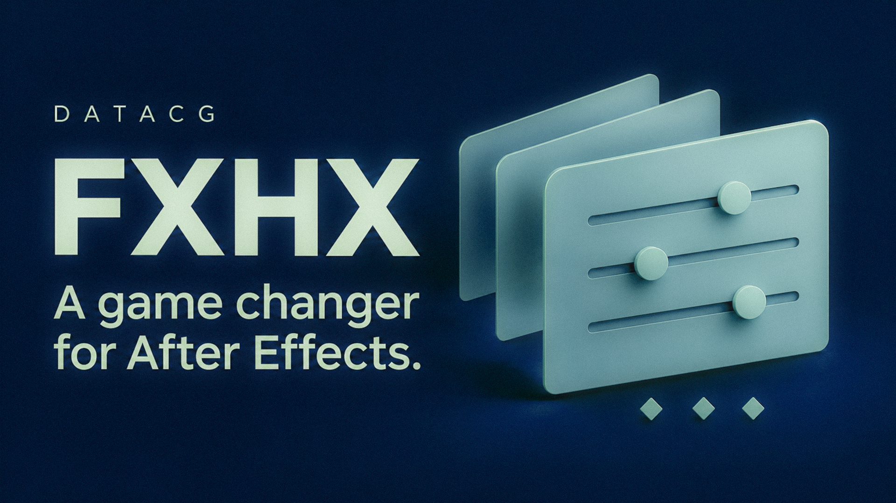

# FXHX

**A game changer for After Effects.**

Encontre, compare e altere parâmetros de efeitos em lote no Adobe After Effects.

**FXHX (FX Exchanger)** é um painel ExtendScript/ScriptUI para Windows. Você seleciona os efeitos que quer editar, confere os valores atuais e prepara várias alterações para aplicar em um único lote.

## Download e instalação

Baixe o [ZIP da versão mais recente](https://github.com/datacg/fxhx/releases/latest) e extraia `FX Exchanger.jsx`. Também é possível baixar apenas o JSX na mesma página.

1. Feche o painel, se já estiver aberto.
2. Copie `FX Exchanger.jsx` para a pasta `Scripts/ScriptUI Panels` da instalação do After Effects.
3. Abra **Window → FX Exchanger.jsx**. Confira a versão em **Help**.

O painel não precisa de Node.js ou npm para funcionar. [Instruções de instalação](INSTALL.md).

## Como usar

1. Escolha o escopo e use **Search** ou **Scan** para localizar os efeitos.
2. Selecione as ocorrências. **Ctrl** alterna a seleção; **Shift** seleciona um intervalo.
3. Clique **Edit Parameters...**. Busque os parâmetros e preencha somente os valores que quer alterar.
4. Confira os valores anteriores, as pendências e os alvos. **Apply** confirma e aplica o lote.

Quando os valores forem diferentes, o editor mostra **Mixed Values** e os valores anteriores com suas contagens. Por exemplo: **200 (1 efeito) + 100 (1 efeito) → 150 para ambos**. Cada pendência precisa atender toda a seleção; se houver um impedimento, Apply fica bloqueado e explica o motivo.

Também é possível comparar configurações, copiar parâmetros estáticos escolhidos, salvar presets de um efeito e ativar/desativar efeitos selecionados. [Guia de uso](USER_GUIDE.md).

## Keyframes e atualizações

Keyframes são preservados por padrão. Para removê-los de um parâmetro, marque **Remove keyframes** e confirme a remoção. Isso também funciona com uma única key: deixe o novo valor vazio para manter o valor atual de cada efeito, ou informe um valor para substituir todos. Expressions e controles não suportados permanecem protegidos.

Em **Help → Check for updates**, o painel consulta a última Release estável deste repositório. **Open Releases** abre a página de download. A consulta é manual, não envia dados do projeto e não instala atualizações automaticamente.

## Estado da versão

Esta é a primeira versão pública, **0.1.15**. São **253 testes automatizados aprovados**, com build ES3 e verificação do pacote. A validação visual e funcional dentro do After Effects ainda está pendente; veja [VALIDATION.md](VALIDATION.md) e o [roteiro de testes manuais](docs/UI_QA.md).

Falhas da API do host podem deixar alterações parciais. Confira **Results** antes de repetir uma operação; o painel não repete escritas incertas automaticamente. A compatibilidade com controles privados de plugins de terceiros depende do que cada efeito expõe.

## Apoie o desenvolvimento

O FXHX é gratuito. Se ele facilitou seu trabalho, você pode contribuir voluntariamente para apoiar seu desenvolvimento e outros projetos da DATACG.

**[Apoiar DATACG no Ko-fi](https://ko-fi.com/datacg)**

## Desenvolvimento

Requer Node.js 18 ou superior. No Windows:

```powershell
npm.cmd ci
npm.cmd run check
npm.cmd run release
```

O código fica em `src/`; o build gera `dist/FX Exchanger.jsx`. O pacote é criado em `release/`. Esses comandos não iniciam o After Effects. [Testes](TESTING.md) · [Arquitetura](ARCHITECTURE.md) · [Changelog](CHANGELOG.md).

Encontrou um problema? [Abra uma issue](https://github.com/datacg/fxhx/issues) com a versão do painel, versão do After Effects e passos para reproduzir. Remova dados pessoais ou do projeto antes de compartilhar logs.
